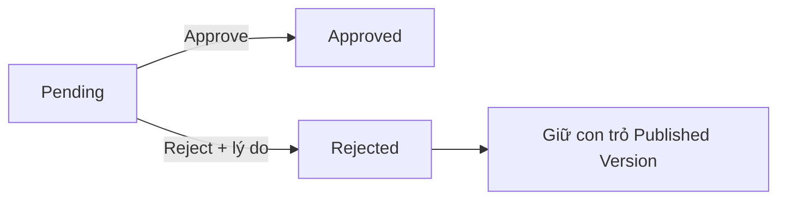
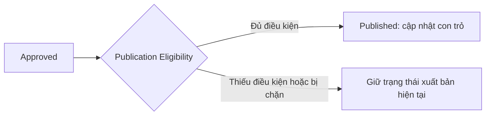
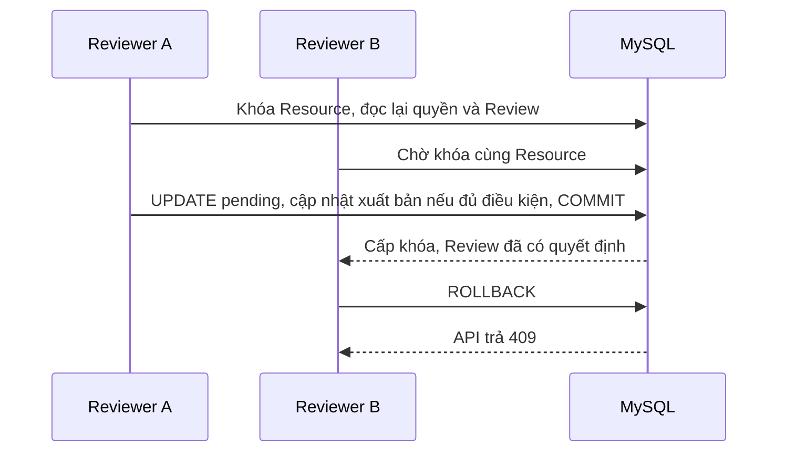

# School & Government Review APIs — Phase 2.5

School Administrator xử lý Resource được giao cho đúng trường của tài khoản. Government xử lý đóng góp độc lập có `review_scope=government` và `review_school_id=NULL`. Cả hai dùng chung Review Service, middleware session, vai trò và kiểm tra `Origin` cho POST. Reviewer được lấy từ tài khoản trên server. Teacher giữ quyền xem lịch sử của Resource mình sở hữu qua API Phase 2.4.

## API

Các tuyến dưới đây áp dụng cho cả `/api/school/reviews` và `/api/government/reviews`.

| Phương thức và đường dẫn | Hành vi |
| --- | --- |
| `GET /pending` | Pending Review của đúng phạm vi, sắp theo `submitted_at DESC, review_id DESC` |
| `GET /history` | Approved và Rejected, sắp theo `reviewed_at DESC, review_id DESC` |
| `GET /:id` | Metadata Version và Resource, tác giả, quyền, quyết định, tóm tắt tối đa 20 Review đã hoàn tất của cùng Resource |
| `GET /:id/preview` | Tải PDF riêng tư bằng cookie reviewer, nếu đúng phạm vi và tệp còn tồn tại |
| `POST /:id/approve` | Body tùy chọn `{"note":"Phù hợp"}`. Ghi approval rồi đánh giá điều kiện xuất bản |
| `POST /:id/reject` | Body bắt buộc `{"note":"Thiếu căn cứ phân phối"}`. Ghi rejection và giữ nguyên con trỏ xuất bản |

Danh sách trả `{ data, pagination: { page, limit, total } }`. `page` bắt đầu từ 1, mặc định `limit=20`, tối đa 100. Hỗ trợ `search` theo chuỗi con của tiêu đề và `from`, `to` dạng `YYYY-MM-DD`, bao gồm cả hai ngày theo UTC. Queue lọc theo ngày gửi, history theo ngày ra quyết định. History nhận thêm `decision=approved|rejected`. School ID trong tài khoản xác định phạm vi. API từ chối `school_id` đưa vào query hoặc body. ID trong JSON là chuỗi.

School bị đình chỉ sẽ nhận `403` trên Pending Queue và thao tác ra quyết định. School Admin vẫn phải có tài khoản active để xem History, chi tiết và preview của Review đã có quyết định. Đình chỉ School không thay đổi Resource đã xuất bản. Government có tuyến riêng để rút xuất bản, bao gồm cả Resource theo School scope.

## Quyết định và xuất bản





Review thuộc một Version theo `resource_reviews.version_id`. Version thuộc Resource theo `resource_versions.resource_id`. `resources.review_school_id` quyết định School scope, còn `users.school_id` giới hạn quyền School Admin. Review decision là kết quả kiểm duyệt Version. Publication status và Published Version là trạng thái và con trỏ riêng của Resource. Khi đủ điều kiện, chỉ Version vừa được duyệt và thuộc đúng Resource mới có thể thay con trỏ. Một Version cũ hơn không được thay bản mới đang công bố.

Version phải submitted, có Review approved, access `public`, loại nội dung được hỗ trợ và nội dung còn khả dụng. Quyền hợp lệ gồm `own_work`, `open_license`, `authorized_distribution`, `official_link`. Giá trị `official_link` yêu cầu External Link HTTPS, chỉ lưu URL. Backend không tải nội dung từ URL và frontend tương lai cần xử lý URL như dữ liệu không đáng tin. Tệp PDF phải còn trong kho riêng. Giấy phép mở và quyền phân phối là thông tin khai báo. Duyệt bởi School hoặc Government không chứng minh sở hữu bản quyền hay quyền phân phối thực tế.

Phản hồi `200` khi approval thành công nhưng Version mới là restricted:

```json
{
  "review_id": "101",
  "resource_id": "12",
  "version_id": "31",
  "decision": "approved",
  "review_note": null,
  "reviewer_id": "8",
  "reviewed_at": "2026-11-24T01:00:00.000Z",
  "publication_occurred": false,
  "publication_reason": "ACCESS_RESTRICTED",
  "publication_status": "published",
  "published_version_id": "28"
}
```

Các lý do khác gồm `RIGHTS_NOT_ELIGIBLE`, `CONTENT_UNAVAILABLE` và `ADMINISTRATIVE_HOLD`. Nếu xuất bản diễn ra, `publication_reason` là `null`. Rejection yêu cầu nội dung sau khi trim, tối đa 2.000 ký tự, và giữ tất cả Version và Review.

## Withdrawal và reinstatement

Từ Phase 3.2, `POST /api/government/resources/:id/withdraw` nhận `{"reason":"Quyền phân phối đã hết hiệu lực"}`. Cùng khóa Resource, API chuyển publication sang hidden, đánh dấu withdrawn, giữ Published Version pointer và lưu lý do lần rút gần nhất. Version và Review vẫn còn. Approval sau đó có thể hoàn tất Review nhưng giữ trạng thái ẩn.

Chỉ Government có thể gọi `POST /api/government/resources/:id/reinstate` với `{"version_id":"12"}`. API kiểm tra lại Review, access, rights và khả dụng nội dung trước khi công bố. `legacy_hold` giữ ẩn dữ liệu cũ không thể phân biệt chính xác. [Migration, rollback và contract](../../docs/DATA_INTEGRITY_REPORT.md)

## Transaction và các yêu cầu đồng thời



Review và Submit dùng cùng khóa Resource. Sau đó theo thứ tự School, user, Version và Review liên quan. Dùng điều kiện `WHERE decision='pending'` và kiểm tra đúng một dòng cập nhật. Lỗi ghi quyết định hoặc con trỏ rollback toàn bộ. Deadlock hoặc lock timeout trong transaction được thử lại một lần từ đầu. Khi tiếp tục xung đột, trả `409 REVIEW_BUSY`. Không tự retry COMMIT nếu mất phản hồi. Kiểm tra tệp cục bộ trước transaction và đối chiếu tham chiếu bất biến sau khi khóa. Các Version submitted và Review hoàn tất được giữ nguyên.

## Bảo mật, kiểm thử và triển khai

Preview yêu cầu session reviewer và đúng scope. Server chỉ mở tham chiếu UUID là tệp thường trong kho riêng, gửi `application/pdf` dưới dạng attachment và đặt `Cache-Control: private, no-store`. JSON không chứa đường dẫn tệp. Preview dành cho reviewer có quyền và không tạo URL tải công khai. Kiểm tra định dạng PDF và metadata quyền chưa thay thế quét malware hoặc xác minh pháp lý.

Các lỗi trả `{ "error": { "code": "...", "message": "..." } }`, gồm `400` đầu vào sai, `401` thiếu session hay tài khoản active, `403` vai trò, School status hoặc Origin sai, `404` đối tượng ngoài scope hoặc PDF không tồn tại, `409` xung đột, `500` lỗi bất ngờ và `503` lỗi kết nối MySQL. Thông báo trả về đã được lọc.

Đăng nhập qua `/api/auth/login` bằng School Admin hoặc Government. Giữ cookie trong Postman hoặc với `-SessionVariable reviewerSession` của PowerShell. Thêm Origin thuộc `AUTH_ORIGINS` cho POST:

```powershell
$base = 'http://127.0.0.1:3000/api/school/reviews'
Invoke-RestMethod "$base/pending?limit=10" -WebSession $reviewerSession
Invoke-RestMethod "$base/101/approve" -WebSession $reviewerSession -Method Post -Headers @{ Origin = 'http://127.0.0.1:3000' } -ContentType 'application/json' -Body '{"note":"Phu hop"}'
```

`npm.cmd test` chạy bộ hồi quy, kiểm thử publication policy, validation và retry giả lập. Để chạy HTTP end-to-end trên MySQL, nạp business schema và session migration vào database cô lập tên `learning_bridge_review_test` hoặc `learning_bridge_auth_test` trên loopback. Test tạo School, tài khoản, Resource, PDF và kiểm tra rollback khi lỗi ghi xuất bản được mô phỏng. Dùng tài khoản test có quyền theo README.

```powershell
$env:RUN_MYSQL_REVIEW_TEST = '1'
npm.cmd run test:db
Remove-Item Env:RUN_MYSQL_REVIEW_TEST
```

Phase tiếp theo là Student Public APIs. Khi triển khai, truy vấn công khai cần chặn Resource `hidden` và xác nhận quan hệ giữa Resource, Published Version, Review approved và điều kiện truy cập hiện hành.
