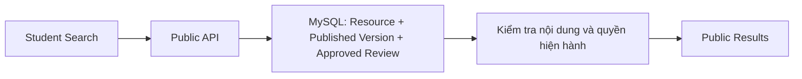
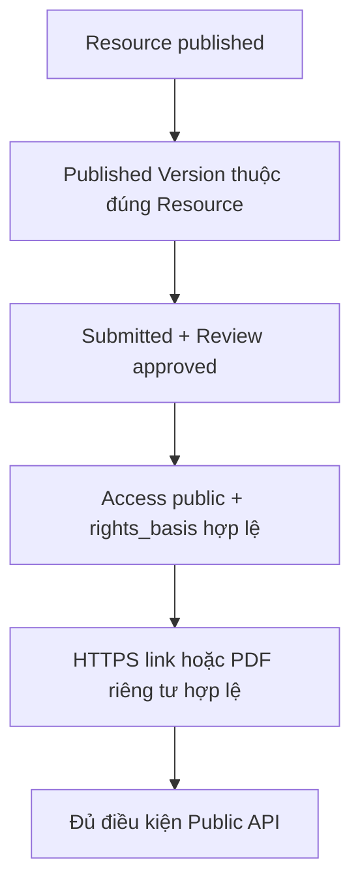
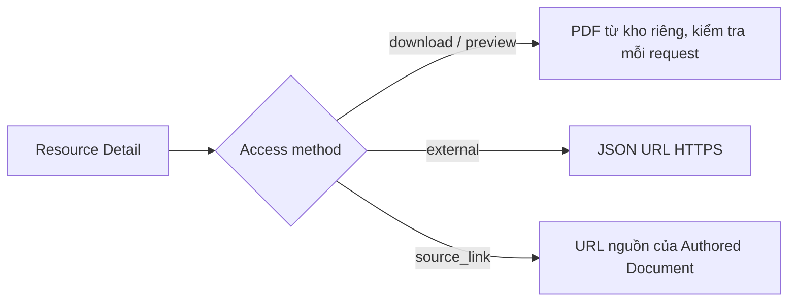

# Student Public APIs — Phase 2.6

Student và khách truy cập dùng `/api/public` không cần tài khoản hoặc session. Router chỉ đọc dữ liệu. Controller định dạng JSON hoặc stream PDF. Service kiểm tra eligibility và dựng phản hồi public từ danh sách trường được phép. Repository dùng mysql2/promise và SQL tham số hóa.



## Endpoints

| Phương thức và đường dẫn | Kết quả |
| --- | --- |
| `GET /api/public/resources` | Danh sách Published Versions đủ điều kiện, bộ lọc và phân trang |
| `GET /api/public/resources/:id` | Chi tiết public và `access_methods` |
| `GET /api/public/resources/:id/download` | PDF với `Content-Disposition: attachment` |
| `GET /api/public/resources/:id/preview` | PDF với `Content-Disposition: inline` và CSP |
| `GET /api/public/resources/:id/external-link` | JSON với URL HTTPS cho `external_link` |
| `GET /api/public/filters` | Categories, education levels và resource types từ Resource đủ điều kiện |

```powershell
$base = 'http://127.0.0.1:3000/api/public'
Invoke-RestMethod "$base/resources?search=Bai%20hoc&limit=12&sort=newest"
Invoke-RestMethod "$base/filters"
Invoke-RestMethod "$base/resources/100"
Invoke-RestMethod "$base/resources/100/external-link"
Invoke-WebRequest "$base/resources/101/download" -OutFile resource-101.pdf
```

Ví dụ phản hồi tìm kiếm:

```json
{
  "data": [{
    "id": "100",
    "title": "Python Basics",
    "description": "Introduction to Python programming",
    "author_name": "Nguyen Van A",
    "category": "Computer Science",
    "education_level": "University",
    "resource_type": "external_link",
    "version_number": 1,
    "created_at": "2026-11-24T08:00:00.000Z"
  }],
  "pagination": { "page": 1, "limit": 12, "total": 1, "total_pages": 1 }
}
```

ID dùng chuỗi để giữ độ chính xác BIGINT. `created_at` là thời gian tạo Resource, diễn giải theo UTC và trả ISO 8601. `total_pages` bằng 0 khi không có kết quả. Chi tiết bổ sung `resource_id`, `rights_basis` và `access_methods`. ID sai định dạng hoặc query ngoài allowlist trả `400`. Resource không tồn tại, ngoài phạm vi public hoặc không hỗ trợ phương thức truy cập yêu cầu đều trả cùng JSON `404`.

## Search, lọc và phân trang

`search` so khớp chuỗi con trên `title`, `description`, `author_name`. `category`, `education_level`, `resource_type` có thể kết hợp. `search` và bộ lọc văn bản dài tối đa 100 ký tự. Ký tự `%`, `_`, `!` trong từ khóa được tìm như văn bản. MySQL 8.4.9 với `utf8mb4_0900_ai_ci` đã cho kết quả `Bai hoc moi` khớp `Bài học mới`, `Chuong trinh` khớp `Chương trình` và `Dang Anh` khớp `Đặng Ánh`. Đây là các mẫu đã chạy. Tính tương đương phụ thuộc collation, từng ký tự và cách Unicode biểu diễn chuỗi. API chưa hỗ trợ sửa lỗi chính tả hay xếp hạng độ liên quan.

`page` mặc định 1, tối đa 1.000.000. `limit` mặc định 12, tối đa 50. Sort hỗ trợ `newest` mặc định, `oldest`, `title_asc`, `title_desc`. Hai kiểu thời gian dựa trên thời điểm tạo Resource. ID làm khóa phụ để thứ tự ổn định. Filter metadata bỏ giá trị rỗng, gộp giá trị sau trim theo Unicode NFC và chữ thường, rồi sắp xếp theo locale tiếng Việt. Chỉ giá trị gắn với Resource hiện đủ điều kiện được trả.

Repository JOIN Resources, Published Version của đúng Resource và Review approved bằng các khóa hiện có. Kiểm tra file cần filesystem, nên để trả tổng chính xác, danh sách và filters đọc lô 64 ứng viên theo keyset trong snapshot MySQL chỉ đọc rồi kiểm tra metadata và tệp. Cách này giới hạn kích thước lô và không phát sinh truy vấn SQL riêng cho từng tài nguyên, nhưng tổng chi phí vẫn tăng theo số ứng viên. Search và filters chia sẻ giới hạn 60 request/IP/phút và tối đa hai lượt quét đồng thời mỗi tiến trình. Chưa thêm FULLTEXT hay index mới.

## Published Version và withdrawal



Service tái sử dụng publication policy Phase 2.5. Published Version do `published_version_id` xác định và có thể cũ hơn Draft hoặc Review mới. Public API chỉ serialize dữ liệu của Published Version. Withdraw đặt Resource thành `hidden` và xóa con trỏ theo schema, đồng thời giữ Review và Version. Mọi truy vấn public đều loại `hidden`. PDF được đối chiếu DB lần nữa sau khi mở tệp và mọi phản hồi public đều có `Cache-Control: no-store`. Withdrawal chặn yêu cầu mới. Luồng truyền đã bắt đầu và bản sao đã tải vẫn có thể tồn tại ngoài kiểm soát của API.

Schema thiếu dấu withdrawal riêng và audit reason. Quy tắc Phase 2.5 giữ nguyên: Resource hidden có lịch sử approved sẽ không tự xuất bản lại. Quy tắc cũng chặn một số Resource chưa từng xuất bản. Migration tương lai có thể thêm `withdrawn_at`, `withdrawn_by`, `withdrawal_reason` và một thao tác reinstatement được ủy quyền.

## PDF và External Link



PDF dùng tham chiếu UUID trong kho riêng. Server từ chối đường dẫn tùy ý, symlink hoặc junction thoát thư mục, kiểm tra tệp thường, định dạng PDF cơ bản và giới hạn kích thước theo `TEACHER_PDF_MAX_BYTES`. Nội dung được đọc qua file descriptor đã xác minh. Tên tải là `resource-<id>.pdf`, dùng MIME `application/pdf`, `nosniff` và CSP sandbox. Preview dùng inline để browser có thể mở trình xem PDF được hỗ trợ. CSP giới hạn nhúng vào cùng origin. Một số browser hoặc trình xem có thể buộc tải xuống. Kiểm tra cấu trúc không phải quét malware.

`external-link` trả `{ "resource_id": "100", "resource_type": "external_link", "url": "https://example.org/course", "access_method": "external" }`. Backend xác thực URL lưu trong DB và trả JSON. API không proxy, tải hoặc redirect theo URL nhận từ người gọi. Authored Document có nguồn HTTPS và chưa có tệp sử dụng được trả `source_link` cùng `source_url` trong detail, còn endpoint `external-link` dành cho loại `external_link`. URL công khai là dữ liệu bên thứ ba. Frontend tương lai có thể hiển thị thông báo trước khi người dùng mở. `official_link` là khai báo nguồn và không chứng nhận nhà xuất bản hoặc quyền phân phối. Sách giáo khoa được dẫn tới nguồn được phép, và việc lưu bản sao cần quyền phân phối.

## Kiểm thử và tích hợp tương lai

Chạy `npm.cmd test` để kiểm tra validator, lọc dữ liệu giả lập, thu hồi quyền trong lúc mở tệp và an toàn đường dẫn. Để chạy HTTP end-to-end với MySQL, nạp business schema và session migration vào schema test cô lập `learning_bridge_public_test` hoặc `learning_bridge_auth_test` trên loopback. Tài khoản test cần quyền ghi fixture và Review theo README. Public API chỉ cần quyền đọc các bảng Resource, Version và Review ở runtime.

```powershell
$env:RUN_MYSQL_PUBLIC_TEST = '1'
npm.cmd run test:db
Remove-Item Env:RUN_MYSQL_PUBLIC_TEST
```

Kiểm thử hồi quy đồng thời của Teacher làm rõ nhu cầu giới hạn truy vấn khóa Review vào đúng Resource. Phase này dùng index duy nhất theo Version cho locking reads và cho phép Submit thử lại toàn bộ transaction một lần khi gặp deadlock hoặc lock timeout. Có thể nhận 409 nếu tranh chấp tiếp diễn. Chính sách duyệt và withdrawal giữ nguyên.

Phase 2.7 tích hợp các giao diện, cấu hình `CORS_ORIGINS` cho frontend chạy origin riêng, rồi kiểm thử tìm kiếm, hiển thị URL bên thứ ba, tải PDF và hành vi preview trên browser thật. Public APIs không cần gửi cookie.
