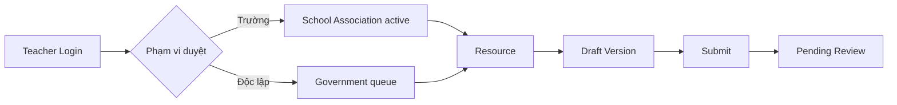

# Teacher APIs — Phase 2.4

Router `/api/teacher` dùng session, `requireAuth`, `requireRole('teacher')` và kiểm tra `Origin` với POST/PATCH. Controller xử lý HTTP, service kiểm tra nghiệp vụ, repository dùng SQL tham số hóa. `owner_id` lấy từ session. Tra cứu Version và Review đi qua Resource thuộc Teacher. Resource của người khác trả cùng `404` như Resource không tồn tại.



## Endpoints

Tất cả đường dẫn dưới đây có tiền tố `/api/teacher`. ID trong phản hồi là chuỗi số để giữ độ chính xác của MySQL BIGINT. JSON gửi ID dưới dạng chuỗi hoặc số nguyên JavaScript an toàn.

| Phương thức và đường dẫn | Dữ liệu | Phản hồi |
| --- | --- | --- |
| `GET /profile` | — | `200` với `id`, `full_name`, `email`, `role`, `status`, `created_at` |
| `GET /schools/available` | — | `200`, danh sách trường active gồm ID, mã và tên |
| `GET /schools` | — | `200`, liên kết đã khai báo và trạng thái trường |
| `POST /schools` | `school_id`, `teacher_code` | `201` khi tạo, `200` khi mở lại liên kết inactive |
| `PATCH /schools/:id/status` | `status: "active"` hoặc `"inactive"`, ID là association ID | `200`, liên kết cập nhật |
| `GET /resources` | `page`, `limit`, `review_scope`, `publication_status`, `decision` | `200` với `{ data, pagination: { page, limit, total } }` |
| `POST /resources` | Phạm vi và metadata của Version đầu tiên | `201`, ID của Resource và Version 1 |
| `GET /resources/:id` | — | `200`, Resource, trường, Versions và trạng thái Review |
| `GET /resources/:id/reviews` | — | `200`, lịch sử Review hoặc `[]` |
| `POST /resources/:id/versions` | `source_version_id` tùy chọn | `201`, Draft Version mới |
| `PATCH /versions/:id` | Một hoặc nhiều trường metadata | `200`, Draft Version cập nhật |
| `POST /versions/:id/upload` | `multipart/form-data` gồm một part tên `file` | `200`, Version với `has_file: true` |
| `POST /versions/:id/submit` | — | `201`, Pending Review |

Danh sách Resource sắp theo ID giảm dần, mặc định 20 và tối đa 100 dòng/trang. Tiêu đề lấy từ Version mới nhất. Bộ lọc `decision` dùng Review gần nhất theo thứ tự Version, kể cả khi có Draft mới chưa gửi.

## Khai báo trường và tạo Resource

Ví dụ khai báo `{"school_id":"1","teacher_code":"GV12345"}`. Backend dùng pattern hiện hành do Government đặt. Hai liên kết cùng Teacher và School dùng chung một hàng. POST với liên kết active trả `409`. Với liên kết inactive, POST có thể cung cấp mã mới và mở lại hàng cũ. PATCH active kiểm tra lại mã đã lưu. Inactive chặn lần gửi mới và giữ nguyên hàng chờ, liên kết và lịch sử. Bất kỳ ai biết định dạng đều có thể tạo chuỗi khớp. Kết quả chỉ phản ánh định dạng, không chứng minh danh tính hay công việc tại trường.

```json
{
  "review_scope": "school",
  "review_school_id": "1",
  "title": "Python Basics",
  "description": "Introduction to Python programming",
  "author_name": "Nguyen Van A",
  "category": "Computer Science",
  "education_level": "University",
  "resource_type": "external_link",
  "source_url": "https://example.org/python-basics",
  "rights_basis": "official_link",
  "access_level": "public"
}
```

Chọn `review_scope: "government"` và bỏ `review_school_id` hoặc đặt `null` cho đóng góp độc lập. Tạo phạm vi School yêu cầu trường và liên kết active cùng mã khớp pattern hiện hành. `author_name` mặc định theo hồ sơ Teacher. `rights_basis` mặc định `unknown`, `access_level` mặc định `restricted`. Resource và Version 1 được tạo trong cùng transaction. Ví dụ phản hồi:

```json
{
  "resource_id": "100",
  "version_id": "502",
  "version_number": 1,
  "publication_status": "hidden",
  "edit_state": "draft"
}
```

## Draft, PDF và External Link

Draft cho phép sửa `title`, `description`, `author_name`, `category`, `education_level`, `resource_type`, `source_url`, `rights_basis` và `access_level`. Thay đổi được kiểm tra trên toàn bộ trạng thái sau khi gộp. Submitted Versions bất biến. Khi Resource hết Draft và Pending Review, POST tạo Draft mới sao chép metadata từ Version trong cùng Resource, mặc định Version mới nhất. Draft có thể kế thừa cùng tham chiếu tệp. Upload sau đó luôn tạo tham chiếu mới, giữ byte của tệp cũ cho Version đã duyệt hoặc đã xuất bản.

DDL yêu cầu Version kiểu `pdf` có `file_path`. Để bắt đầu từ metadata chưa có tệp, tạo Draft kiểu `authored_document` và khai báo quyền phân phối, rồi upload để chuyển sang `pdf`. `authored_document` cần nội dung dưới dạng tệp hoặc URL hợp lệ trước khi gửi. `external_link` cần HTTPS, không nhận upload. Backend kiểm tra cú pháp và từ chối URL chứa thông tin đăng nhập hoặc scheme khác. Backend không truy cập URL.

Chỉ nhận PDF với `TEACHER_PDF_MAX_BYTES` mặc định 10 MiB, tối đa cấu hình 25 MiB và tối đa bốn upload đồng thời mỗi tiến trình. Multer giới hạn số part. Backend kiểm tra cấu trúc tối thiểu gồm header, trailer và vị trí cross-reference. Kiểm tra này không thay thế trình phân tích PDF đầy đủ, kiểm tra malware hoặc kiểm chứng quyền tác giả. Tệp dùng tên UUID tạo trên server, ghi độc quyền vào `backend/private-uploads/`. Thư mục này bị loại khỏi Git và cần nằm ngoài mọi cấu hình static hoặc reverse proxy file serving. CSDL lưu tham chiếu, API trả `has_file`.

Ghi tệp hoàn tất trước khi cập nhật tham chiếu trong transaction. Lỗi đã rollback xóa tệp mới. Lỗi không xác định kết quả COMMIT giữ tệp để đối soát. Hệ thống giữ tham chiếu cũ khi tệp có thể được kế thừa. Nếu gặp crash hoặc tệp không còn tham chiếu sau khi thay tệp, chỉ xóa khi đã dừng thao tác ghi, đối chiếu toàn bộ `resource_versions.file_path` và có sao lưu. Triển khai nhiều instance cần kho riêng dùng chung.

Tệp yêu cầu khai báo `own_work`, `open_license` hoặc `authorized_distribution`. `official_link` dành cho External Link. Public access không đi cùng `unknown`. Sách giáo khoa chính thức cần dẫn URL nguồn hoặc có quyền phân phối trước khi lưu bản sao. Teacher chịu trách nhiệm về khai báo. Review approval không xác nhận quyền tác giả.

## Gửi duyệt và đọc lịch sử

Các thao tác tạo Version, sửa Draft, upload và submit khóa hàng `resources` bằng `SELECT … FOR UPDATE`. Submit tái kiểm tra Teacher active và, với scope School, khóa và kiểm tra trường, liên kết và pattern trước khi đọc Version hiện hành. Backend kiểm tra nội dung, quyền truy cập và Pending Review hiện có, sau đó đổi Draft sang Submitted và ghi một Pending Review trong cùng transaction. Các đường ghi cho Resource ở phase sau phải dùng cùng giao thức khóa.

```json
{
  "resource_id": "100",
  "version_id": "502",
  "review_id": "901",
  "decision": "pending",
  "message": "Resource version submitted for review"
}
```

`users → resources → resource_versions → resource_reviews` là chuỗi chủ sở hữu, Version và Review. `teacher_schools` nối Teacher với School. `resources.review_school_id` xác định hàng chờ School, còn `government` vào hàng chờ độc lập. Ràng buộc PK/FK và UNIQUE bảo vệ từng quan hệ. Giới hạn một Pending Review theo Resource cần transaction ở Backend. Review trả số Version, ID, quyết định, ghi chú, thời gian và tên hiển thị người duyệt nếu có. `published` được tính từ `publication_status` và `published_version_id`, kể cả khi Version khác được duyệt. Teacher chỉ đọc quyết định và xuất bản, không có API thay đổi hai trạng thái này.

## Kiểm thử và giới hạn

Trong PowerShell, đăng nhập bằng API Phase 2.2, giữ cookie qua `-SessionVariable teacherSession`, rồi gọi `Invoke-RestMethod http://127.0.0.1:3000/api/teacher/profile -WebSession $teacherSession`. Thêm header `Origin` đã khai báo vào POST/PATCH. Trong Postman, bật cookie jar, chọn form-data với trường File tên `file` cho upload.

Các lỗi trả `{ "error": { "code": "...", "message": "..." } }`. `400` đầu vào sai, `401` thiếu session hợp lệ, `403` thiếu vai trò hoặc Origin không hợp lệ, `404` dữ liệu không tồn tại trong phạm vi Teacher, `409` xung đột trạng thái, `413` quá kích thước và `429` quá số upload đồng thời. Lỗi ngoài dự kiến trả thông báo đã lọc.

`npm.cmd test` chạy bộ hồi quy, validation và kiểm thử lưu tệp/rollback giả lập. Để chạy HTTP end-to-end trên MySQL, nạp schema và migration session vào database test riêng trên loopback tên `learning_bridge_teacher_test` hoặc `learning_bridge_auth_test`. Test cần quyền thêm dữ liệu fixture, đổi trạng thái Review, chỉnh pattern trường và cập nhật con trỏ xuất bản trong schema test để mô phỏng các trạng thái của phase sau. Chạy từ `backend/`:

```powershell
$env:RUN_MYSQL_TEACHER_TEST = '1'
npm.cmd run test:db
Remove-Item Env:RUN_MYSQL_TEACHER_TEST
```

MVP lưu PDF cục bộ, giữ scope do Teacher chọn ngay khi tạo và chưa có API tải tệp xuống. Browse công khai, quyết định review và xuất bản thuộc các phase tiếp theo.
