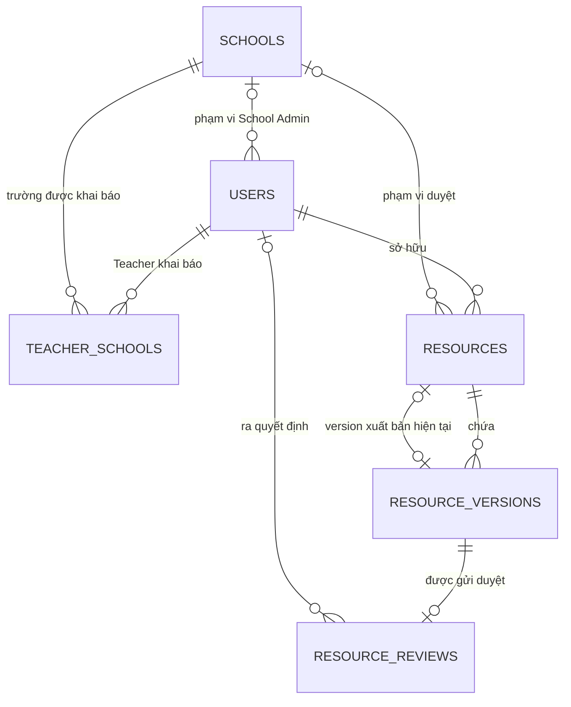

# Thiết kế MySQL Learning Bridge v1.0

## Mô hình dữ liệu

`users` lưu ba vai trò có tài khoản. `schools` lưu trường do Government quản lý. `teacher_schools` lưu liên kết Teacher–School do Teacher khai báo. `resources` lưu chủ sở hữu, phạm vi duyệt và trạng thái xuất bản. `resource_versions` lưu nội dung theo phiên bản. `resource_reviews` lưu lượt gửi và kết quả kiểm duyệt của từng version.

Mỗi liên kết Teacher–School tham chiếu đúng một user và một trường, với tối đa một dòng cho mỗi cặp. Một School Admin bắt buộc thuộc một trường. Một resource bắt buộc có owner và chỉ cần trường khi scope là `school`. Một resource có thể chưa có version. Mỗi version thuộc một resource và có tối đa một review. Reviewer chỉ được gán khi có kết quả cuối cùng.

Mỗi bảng có primary key `id`. FK ghép `resources (id, published_version_id) → resource_versions (resource_id, id)` bảo đảm con trỏ xuất bản thuộc chính resource. Schema thêm FK sau khi tạo cả hai bảng. FK mặc định chặn sửa hoặc xóa khóa đang được tham chiếu. Việc lưu lịch sử còn cần hạn chế thao tác `DELETE` bằng quyền và quy trình ứng dụng. [MySQL Foreign Key Constraints](https://dev.mysql.com/doc/refman/8.4/en/create-table-foreign-keys.html)

## Xuất bản và khả năng truy cập

`decision` mô tả kết quả review cho từng version. `publication_status` mô tả khả năng hiển thị của resource. Resource `hidden` có con trỏ NULL, resource `published` có đúng một con trỏ. Phiên bản mới pending hoặc rejected vẫn có thể tồn tại cùng version cũ đã published. Đình chỉ trường chặn review mới. Version đã xuất bản vẫn có thể được truy cập khi quyền phân phối còn hiệu lực.

Backend cần dùng cùng một điều kiện cho danh sách, chi tiết và tải nội dung công khai. Chọn record có `resources.publication_status = 'published'`, join đúng version qua cả ID và resource ID, lọc `edit_state = 'submitted'`, `access_level = 'public'`, review `approved`, đồng thời kiểm tra quyền phân phối hiện hành. Lấy metadata từ version được chọn. Tránh chọn version bằng `MAX(version_number)`. Tệp lưu trong vùng private và được cấp quyền ở thời điểm tải. URL nguồn cần kiểm tra riêng trước khi hiển thị. Khi rút xuất bản hoặc quyền hết hiệu lực, dừng cấp quyền tải và xử lý các quyền truy cập đã cấp theo chính sách lưu trữ.

`rights_basis` là thông tin khai báo. CHECK chặn `unknown` với access `public`. Căn cứ quyền tác giả cần được xem xét riêng. `official_link` dùng để dẫn nguồn chính thức khi phù hợp và không tự cấp quyền lưu bản sao. Tài khoản Backend cần xác thực vai trò và trạng thái từ dữ liệu hiện hành, dùng parameterized queries và giữ cấu hình kết nối ngoài frontend. Backend lưu hash do cơ chế băm mật khẩu tạo ra. SQL chỉ kiểm tra cột hash có nội dung.

## Ranh giới thực thi

- **MySQL** áp dụng PK, FK, UNIQUE, NOT NULL và CHECK nội bộ dòng. Trong đó có vai trò và trường trực thuộc, scope, con trỏ xuất bản, version dương, nguồn/tệp bắt buộc theo loại, tổ hợp review và ghi chú từ chối có nội dung.
- **Transaction** đồng bộ chuyển trạng thái version và review, giới hạn một pending trên mỗi resource, khóa quyết định cuối cùng, giữ nguyên scope sau lần gửi đầu tiên và cập nhật con trỏ xuất bản sau kiểm tra eligibility.
- **Backend** xác định actor, role, owner và phạm vi trường, kiểm tra teacher ID bằng pattern hiện tại, quyền phân phối, định dạng URL, tồn tại và truy cập tệp, cùng tính hợp lệ của bản nháp khi submit. FK tham chiếu user chỉ xác nhận user tồn tại. [MySQL CHECK Constraints](https://dev.mysql.com/doc/refman/8.4/en/create-table-check-constraints.html)

## Giao thức transaction

Mọi luồng ghi ảnh hưởng tới resource, gồm cả sửa draft, cấp số version và đổi scope, phải chạy trên một kết nối trong một transaction. Khóa dòng resource theo PK bằng `SELECT ... FOR UPDATE` trước khi đọc trạng thái dùng để quyết định. Nếu điểm vào chỉ biết version ID, tra resource ID để xác định khóa rồi đọc lại liên kết sau khóa. Nếu có nhiều resource, khóa theo ID tăng dần. Khóa và đọc lại trường, user và association liên quan theo thứ tự thống nhất (trường, user, association rồi version và review, ID tăng dần trong mỗi nhóm). Các luồng sửa trạng thái hoặc pattern phải dùng khóa trên chính các dòng liên quan. Luồng đình chỉ trường chỉ cần cập nhật trường. Dùng locking reads cho các kiểm tra quyết định sau khi lấy khóa để đọc trạng thái hiện hành, kể cả dưới `REPEATABLE READ`. [MySQL InnoDB Locking Reads](https://dev.mysql.com/doc/refman/8.4/en/innodb-locking-reads.html)

1. **Gửi version.** Khóa resource rồi nạp và khóa các dòng liên quan. Xác nhận owner là Teacher active, version thuộc resource và còn draft. Với scope School, xác nhận trường active, association active và mã khớp pattern hiện tại. Dùng locking read tìm review pending của resource qua `resource_versions`. Nếu đã có pending, rollback. Với scope dự kiến sửa, chỉ cho phép trước khi có review đầu tiên, kể cả review đã final. Cập nhật `pattern_checked_at` sau khi pattern hợp lệ, đổi version bằng `UPDATE ... WHERE id = ? AND edit_state = 'draft'` và thêm review pending. Đòi hỏi cập nhật đúng một dòng rồi commit cả hai thay đổi.
2. **Duyệt.** Khóa resource, kiểm tra reviewer active và có quyền theo scope. Với School, kiểm tra đúng trường và trường active. Khóa version đã submitted và review tương ứng. Ghi `approved`, reviewer, thời gian và ghi chú tùy chọn bằng `UPDATE ... WHERE version_id = ? AND decision = 'pending'`. Nếu số dòng cập nhật khác một, rollback và báo xung đột. Nếu duyệt đồng thời xuất bản, thực hiện bước 4 trong cùng transaction rồi commit.
3. **Từ chối.** Thực hiện cùng kiểm tra và cập nhật có điều kiện như bước 2. Yêu cầu lý do có nội dung, ghi kết quả `rejected` và giữ nguyên con trỏ hiện tại. Commit sau khi cập nhật đúng một review. Chỉnh sửa tiếp được tạo thành version mới.
4. **Xuất bản version đã duyệt.** Trong transaction duyệt hoặc một transaction xuất bản riêng, khóa cùng resource và kiểm tra lại version thuộc resource, đã submitted, review approved, access public và quyền phân phối còn hiệu lực. Xác nhận actor có quyền xuất bản theo chính sách Backend. Với thao tác thay phiên bản, so sánh con trỏ hiện tại với giá trị mà người dùng đã xác nhận để phát hiện lệnh cũ hoặc xung đột. Cập nhật `published_version_id` và `publication_status` trong cùng câu lệnh, rồi commit. Nếu bước kiểm tra thất bại trong luồng duyệt kèm xuất bản, rollback cả quyết định lẫn thay đổi con trỏ.
5. **Rút xuất bản.** Khóa resource, xác nhận quyền actor và con trỏ hiện tại. Cập nhật cùng lúc `publication_status = 'hidden'` và `published_version_id = NULL`, giữ nguyên version và review. Commit rồi thực hiện các tác vụ thu hồi quyền tải sau commit.

Nếu có lỗi, rollback toàn transaction. Với deadlock (1213) hoặc lock timeout (1205), rollback rõ ràng rồi thử lại cả transaction với giới hạn, đọc lại dữ liệu và kiểm tra điều kiện từ đầu. Sau khi đối thủ đã commit, request retry phải trả về xung đột nếu pending hoặc con trỏ không còn đúng kỳ vọng. Hoãn tác vụ phụ cho đến khi commit thành công. Hai transaction tuân thủ cùng giao thức sẽ tuần tự trên cùng resource. SQL trực tiếp ngoài giao thức vẫn có thể sửa dữ liệu đã gửi hoặc final và tạo hai pending cho hai version khác nhau. [MySQL InnoDB Error Handling](https://dev.mysql.com/doc/refman/8.4/en/innodb-error-handling.html)

## Index

| Index | Mục đích |
|---|---|
| `uq_users_email`, `uq_schools_code` | Tra cứu email và mã trường, bảo đảm duy nhất |
| `ix_users_school` | Tìm School Admin theo trường và hỗ trợ FK |
| `uq_teacher_schools_pair`, `ix_teacher_schools_school` | Tra liên kết theo Teacher hoặc theo School và hỗ trợ FK |
| `ix_resources_owner`, `ix_resources_school_scope` | Danh sách theo owner hoặc trường và scope, hỗ trợ FK |
| `ix_resources_publication` | Lọc resource theo trạng thái xuất bản |
| `ix_resources_published_version`, `uq_resource_versions_parent_id` | Hỗ trợ hai phía FK ghép của con trỏ xuất bản |
| `uq_resource_versions_number` | Tra version theo resource và số thứ tự, hỗ trợ FK về resource |
| `uq_resource_reviews_version`, `ix_resource_reviews_reviewer` | Tra review theo version, tra quyết định của reviewer và hỗ trợ FK |
| `ix_resource_reviews_decision_queue` | Lọc theo decision và sắp theo thời gian gửi |
